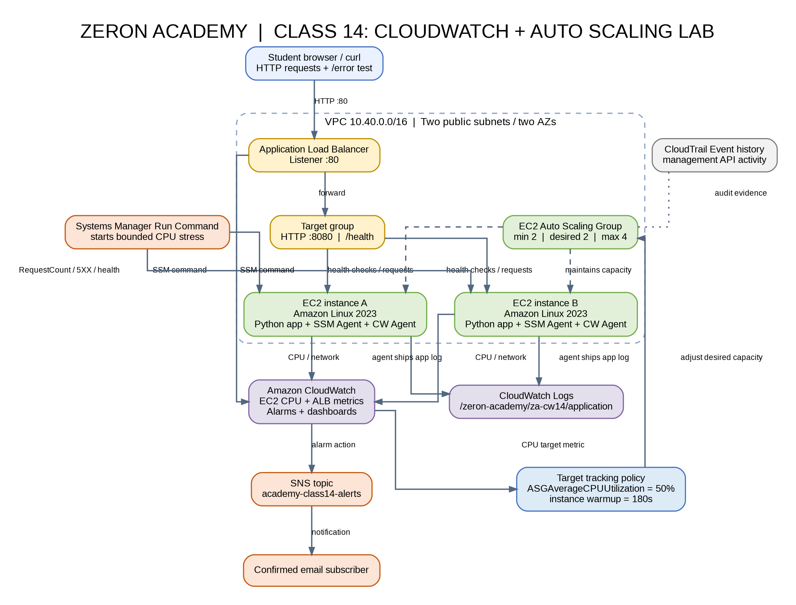
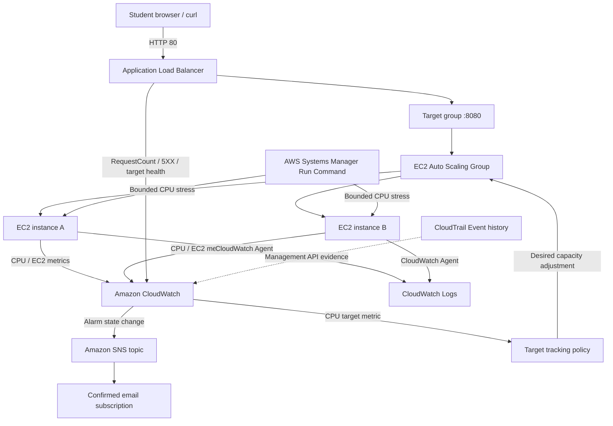

# Zeron Academy — Class 14: CloudWatch Metrics, Alarms, Scaling Policies and Operational Signals

This is a disposable classroom environment for teaching how application and infrastructure signals become metrics, alarms, notifications, and Auto Scaling actions.

## 1. What this lab deploys

- One VPC (`10.40.0.0/16`) across two Availability Zones.
- Two public subnets and an Internet Gateway.
- An internet-facing Application Load Balancer (ALB).
- An ALB target group listening on EC2 port 8080.
- An EC2 Auto Scaling Group with 2 initial instances and a maximum of 4.
- Amazon Linux 2023 instances with detailed monitoring enabled.
- An EC2 instance role with Systems Manager and CloudWatch Agent permissions.
- A small Python web application with `/health` and `/error` endpoints.
- CloudWatch Agent collection for application logs, memory percentage and disk percentage.
- One CloudWatch Logs log group with three-day retention.
- An SNS topic named `academy-class14-alerts`.
- One-minute Auto Scaling group metrics.

The EC2 instances are placed in public subnets to keep this short-lived classroom lab simple and avoid NAT Gateway charges. Their security group allows application traffic only from the ALB security group; it has no inbound SSH rule. The instances have public IPv4 addresses for outbound Systems Manager and package-repository access. This is a classroom topology, not a production placement recommendation. A production design would normally put application instances in private subnets and provide controlled egress through NAT or the required VPC endpoints.

## 2. Architecture



Editable Graphviz source: `class14_architecture.dot`.



## 3. Prerequisites

1. An AWS account in which you are permitted to create VPC, EC2, IAM, ELB, Auto Scaling, CloudWatch, SNS and Systems Manager resources.
2. Terraform CLI 1.5 or later.
3. AWS CLI v2 configured with a classroom identity. Use IAM Identity Center or another approved short-lived credential method where possible.
4. The identity running Terraform must have permission to create the listed resources and pass the EC2 instance role to EC2 (`iam:PassRole`).
5. A browser and an email inbox for confirming the SNS subscription.

Select one Region and keep the AWS Console, AWS CLI and Terraform provider in that same Region. The default is `ap-south-1` (Mumbai).

## 4. Suggested 60-minute class delivery

| Time | Teaching activity | Student outcome |
|---|---|---|
| 0–8 min | Explain metrics, namespace, dimensions, statistic, period and resolution. | Students can describe what makes a CloudWatch time series unique. |
| 8–18 min | Inspect EC2 CPU and ALB metrics. Compare per-instance and load-balancer/target-group signals. | Students can find the correct metric and dimensions. |
| 18–30 min | Create an SNS email subscription and a target 5XX alarm; generate `/error` responses. | Students can connect a threshold breach to an operational notification. |
| 30–45 min | Create CPU target tracking and run the bounded SSM CPU stress command. | Students can observe scale-out and identify the policy-managed alarms. |
| 45–55 min | Inspect ASG Activity history, CloudWatch Logs and CloudTrail Event history. | Students can distinguish metric, application, scaling and API audit evidence. |
| 55–60 min | Discuss missing data, warmup, scale-in and cleanup. | Students can explain operational trade-offs and remove lab resources. |

## 5. Deploy the environment

Open this directory in a terminal.

```bash
cp terraform.tfvars.example terraform.tfvars
terraform init
terraform fmt -recursive
terraform validate
terraform plan -out=tfplan
terraform apply tfplan
```

On PowerShell, `Copy-Item terraform.tfvars.example terraform.tfvars` can be used instead of `cp`.

Check the outputs:

```bash
terraform output
terraform output -raw application_url
terraform output -raw autoscaling_group_name
terraform output -raw sns_topic_arn
terraform output -raw load_balancer_metric_dimension
terraform output -raw target_group_metric_dimension
```

Allow several minutes for EC2 user data to finish, the target group to report healthy targets, and the CloudWatch Agent to begin publishing. Open `application_url`; refresh it several times and confirm that the host name can change as requests are load-balanced.

## 6. Confirm the EC2 instances are ready for SSM

Open **Systems Manager → Fleet Manager → Managed nodes**. The instances should appear as managed nodes and should be online.

You can also use the AWS CLI:

```bash
aws ssm describe-instance-information --region ap-south-1
```

The instance profile includes `AmazonSSMManagedInstanceCore`. No SSH key pair or inbound port 22 is required. If the instances do not appear, check user-data output, the `amazon-ssm-agent` service, instance role attachments, outbound connectivity and Region selection.

## 7. Class walkthrough: metrics first

### Instructor concept briefing: what is an operational signal?

A metric is a time series. Teach students to identify it using this tuple:

```text
Namespace + Metric name + Exact dimension set

Example:
AWS/ApplicationELB
HTTPCode_Target_5XX_Count
LoadBalancer = app/<alb-name>/<alb-id>
TargetGroup  = targetgroup/<target-group-name>/<target-group-id>
```

A dimension is not just a filter displayed on a graph; it is part of the metric's identity. A query with a different dimension set can select a different time series or return no data. Metrics exist in the Region in which they are published.

Explain these terms before the console work:

| Term | Meaning | Classroom example |
|---|---|---|
| Namespace | Logical container for related metrics. | `AWS/EC2`, `AWS/ApplicationELB`, `Academy/EC2`. |
| Metric name | The measurement being published. | `CPUUtilization`, `RequestCount`, `HTTPCode_Target_5XX_Count`. |
| Dimension | Name/value pair that identifies a metric variant. | `InstanceId`, `LoadBalancer`, `TargetGroup`. |
| Period | Window over which CloudWatch aggregates samples into a datapoint. | 60 seconds. |
| Statistic | How samples in a period are summarized. | `Average` CPU; `Sum` for response counts. |
| Threshold | The value at which the metric is considered breaching. | Target 5XX `Sum > 0`. |
| Evaluation periods | How many recent periods CloudWatch evaluates. | 1 period. |
| Datapoints to alarm | How many periods must breach within the evaluation window. | 1 of 1, or 2 of 3. |
| Missing data treatment | How absent samples are interpreted. | `notBreaching` for an error-count metric that emits only when errors occur. |

A CloudWatch alarm has three states: `OK`, `ALARM`, and `INSUFFICIENT_DATA`. `INSUFFICIENT_DATA` is not automatically evidence of an outage: the alarm may be new, the metric may not yet have published a datapoint, or the configured dimension set may be wrong. The missing-data treatment affects how absent datapoints participate in evaluation.

For this lesson, compare three different signal types:

1. **Infrastructure metric:** EC2 `CPUUtilization` tells you how busy the instance is from the hypervisor's view. Detailed monitoring supplies one-minute samples; basic monitoring usually supplies five-minute samples.
2. **Application/load-balancer metric:** `HTTPCode_Target_5XX_Count` tells you how many target-generated HTTP 5XX responses were seen. `HTTPCode_ELB_5XX_Count` is a separate signal for load-balancer-generated 5XX responses.
3. **Operating-system/application telemetry:** the CloudWatch Agent sends memory and disk metrics to the custom `Academy/EC2` namespace and ships `/var/log/academy-app.log` to CloudWatch Logs. Memory and disk are not part of the default EC2 metric set.

An alarm is a stateful threshold evaluator and notification/automation trigger. A target-tracking policy is a control loop: it compares a utilization metric with a target and adjusts ASG desired capacity. Auto Scaling creates and manages the CloudWatch alarms used internally by target tracking. The instructor-created 5XX alarm is for service health notification; it is not the CPU scaling mechanism.

### A. EC2 metrics

1. Open **CloudWatch → Metrics → All metrics**.
2. Select the `EC2` namespace, then per-instance metrics.
3. Select an ASG instance and inspect `CPUUtilization`, `NetworkIn`, `NetworkOut` and status-check metrics.
4. Explain that the launch template enables detailed monitoring. EC2 basic monitoring normally publishes most instance metrics every five minutes; detailed monitoring publishes at one-minute intervals and has additional charges.
5. Explain that CPU is a hypervisor/instance metric. Memory and disk are operating-system metrics; this lab publishes them through the CloudWatch Agent under the custom namespace `Academy/EC2`.

### B. ALB metrics and dimensions

1. Open **CloudWatch → Metrics → All metrics → ApplicationELB**.
2. Inspect the views grouped by load balancer and by load balancer plus target group.
3. Useful metrics include:
   - `RequestCount` — requests for which the ALB selected a target.
   - `TargetResponseTime` — time from forwarding to the target until response headers begin.
   - `HealthyHostCount` and `UnHealthyHostCount` — target health counts.
   - `HTTPCode_Target_5XX_Count` — HTTP 5XX responses returned by targets.
   - `HTTPCode_ELB_5XX_Count` — HTTP 5XX responses generated by the ALB itself.
4. The exact dimension values are available from Terraform outputs:
   - `LoadBalancer` = output `load_balancer_metric_dimension`.
   - `TargetGroup` = output `target_group_metric_dimension`.
5. Explain that a metric name alone is not enough. Namespace, metric name and the exact dimension set identify a CloudWatch time series. ALB metrics are emitted in 60-second intervals when requests are flowing; error metrics may not exist when no errors occur.

## 8. Create and test an SNS email notification

1. Open **Amazon SNS → Topics**.
2. Open `academy-class14-alerts`.
3. Choose **Create subscription**.
4. Protocol: `Email`.
5. Endpoint: enter the instructor's or student's email address during class. Never commit this address to the shared course material or Terraform files.
6. Create the subscription.
7. Open the confirmation email and choose **Confirm subscription**.
8. Return to SNS and verify the subscription status is `Confirmed`.

The topic is created by Terraform. The email subscription is created manually so the published lab does not contain personal email addresses and students can see the confirmation workflow.

## 9. Create a CloudWatch alarm for application 5XX responses

The application has an intentional `/error` endpoint which returns HTTP 500. Use `HTTPCode_Target_5XX_Count` because the error is generated by the target application.

1. First generate a small number of errors:

```bash
APP_URL=$(terraform output -raw application_url)
for i in $(seq 1 10); do
  curl -s -o /dev/null -w '%{http_code}\n' "$APP_URL/error"
done
```

PowerShell equivalent:

```powershell
$appUrl = terraform output -raw application_url
1..10 | ForEach-Object { curl.exe -s -o NUL -w "%{http_code}`n" "$appUrl/error" }
```

2. Open **CloudWatch → Metrics → All metrics → ApplicationELB**.
3. Select the time series for `HTTPCode_Target_5XX_Count` with the lab's `LoadBalancer` and `TargetGroup` dimensions.
4. Choose **Create alarm**.
5. Configure:
   - Statistic: `Sum`.
   - Period: `1 minute` (60 seconds).
   - Threshold: `Greater than 0`.
   - Evaluation periods: `1`.
   - Datapoints to alarm: `1 of 1`.
   - Missing data: `Treat missing data as not breaching`.
6. Under Notifications, choose **In alarm** and select `academy-class14-alerts`.
7. Name the alarm `academy-class14-target-5xx` and create it.
8. Confirm the alarm transitions to `ALARM` and that the confirmed SNS subscriber receives a notification. When the metric returns to a non-breaching value, observe the transition back to `OK`.

Do not use `HTTPCode_ELB_5XX_Count` to prove that the application returned a 500. That metric is for 5XX responses generated by the load balancer. The target application error endpoint is deliberately designed to increment `HTTPCode_Target_5XX_Count`.

### Optional: create the same alarm with Terraform

Set this in `terraform.tfvars` and run `terraform apply` instead of creating the alarm in the console:

```hcl
create_5xx_alarm_with_terraform = true
```

The implementation is in `monitoring.tf`. Do not create both versions with the same alarm name.

## 10. Create target-tracking scaling policy

The default lab leaves the target-tracking policy disabled in Terraform so the class can create it using the console.

1. Open **EC2 → Auto Scaling Groups**.
2. Select the group shown by `terraform output -raw autoscaling_group_name`.
3. Open **Automatic scaling** and choose **Create dynamic scaling policy**.
4. Policy type: `Target tracking scaling`.
5. Metric type: `Average CPU utilization` (`ASGAverageCPUUtilization`).
6. Target value: `50` percent.
7. Instance warmup: `180` seconds as the classroom starting value. Explain that this should be based on measured application bootstrap and stabilization time, not copied blindly into production.
8. Create the policy.
9. Open the Auto Scaling Group's **Monitoring** tab and examine the group metrics. The group metrics collection is enabled at one-minute granularity by Terraform.
10. Open **CloudWatch → Alarms** and identify the alarms automatically created and managed by the target-tracking policy. Do not manually edit those policy-managed alarms; change the scaling policy instead.

### Optional: create target tracking using Terraform

Set this in `terraform.tfvars` and run `terraform apply` instead of creating the policy manually:

```hcl
create_target_tracking_policy_with_terraform = true
```

The equivalent `aws_autoscaling_policy` resource is in `compute_and_alb.tf`. Do not create a second console policy if Terraform is managing it.

## 11. Generate bounded CPU load using Systems Manager Run Command

The image bootstraps `/opt/academy/cpu_stress.py`. It uses Python's multiprocessing module to consume the available vCPUs for a bounded duration. No `stress-ng` package is required.

### Console method

1. Open **Systems Manager → Run Command**.
2. Choose **Run command**.
3. Select document `AWS-RunShellScript`.
4. In Targets, choose **Specify instance tags**.
5. Tag key: `Lab`; tag value: `CloudWatch-ASG-Lab`.
6. In Commands, enter:

```bash
systemd-run --unit=academy-cpu-stress --collect --property=RuntimeMaxSec=240s /usr/bin/python3 /opt/academy/cpu_stress.py --seconds 240
```

7. Set the command timeout to at least 300 seconds and run the command. The script is capped at four minutes; stop it earlier as soon as the scaling signal is visible.
8. Open **CloudWatch → Metrics → EC2 → Per-Instance Metrics** and **EC2 Auto Scaling → Auto Scaling Groups → Monitoring**.
9. Observe CPU utilization, desired capacity, in-service instances and the scaling activity history.
10. The script stops by itself after 240 seconds. To stop the stress unit immediately, use a second Run Command targeting the same tag with:

```bash
systemctl stop academy-cpu-stress.service || true
```

11. Observe the group stabilize and, after CPU falls, scale in toward its minimum capacity of two. Scale-in timing is controlled by target tracking and instance warmup; do not expect it to happen immediately.

To inspect recent scaling activities from a terminal:

```bash
ASG_NAME=$(terraform output -raw autoscaling_group_name)
aws autoscaling describe-scaling-activities \
  --auto-scaling-group-name "$ASG_NAME" \
  --max-records 10 \
  --region ap-south-1
```

### CLI method (Linux/macOS shell)

Start the bounded load:

```bash
aws ssm send-command \
  --region ap-south-1 \
  --document-name "AWS-RunShellScript" \
  --targets "Key=tag:Lab,Values=CloudWatch-ASG-Lab" \
  --parameters '{"commands":["systemd-run --unit=academy-cpu-stress --collect --property=RuntimeMaxSec=240s /usr/bin/python3 /opt/academy/cpu_stress.py --seconds 240"]}'
```

Stop it early:

```bash
aws ssm send-command \
  --region ap-south-1 \
  --document-name "AWS-RunShellScript" \
  --targets "Key=tag:Lab,Values=CloudWatch-ASG-Lab" \
  --parameters '{"commands":["systemctl stop academy-cpu-stress.service || true"]}'
```

The command targets all instances currently carrying the lab tag. A new instance launched after the command starts will not necessarily receive that already-running command.

## 12. Compare the operational signals

| Question | Service / screen | What students should inspect |
|---|---|---|
| Is CPU or network usage changing? | CloudWatch Metrics / EC2 | Per-instance CPU and network time series |
| Is traffic reaching the load balancer? | CloudWatch Metrics / ApplicationELB | RequestCount, TargetResponseTime, healthy target counts |
| Is the application returning server errors? | CloudWatch Metrics / ApplicationELB | HTTPCode_Target_5XX_Count |
| Did a threshold become a problem? | CloudWatch Alarms | State, threshold, period, evaluation periods and state reason |
| Who should be notified? | SNS | Confirmed subscription and alarm action |
| Did Auto Scaling add or remove capacity? | EC2 Auto Scaling Group / Activity | Activity history, desired capacity, instances in service |
| What did the application log? | CloudWatch Logs | `/zeron-academy/za-cw14/application` log streams |
| Which API-level management event occurred? | CloudTrail Event history | Relevant EC2 and Auto Scaling management events |

CloudTrail Event history provides the most recent 90 days of management events for the current account and Region. It is not a replacement for application logs or CloudWatch metrics.

## 13. Troubleshooting checklist

### No ALB metrics

- Confirm that you selected the same Region as Terraform.
- Generate requests to the ALB URL; ALB metrics are not all continuously published when no traffic flows.
- Confirm the target group has registered targets.
- Select the exact metric dimensions, not a similar metric with a different dimension set.

### Target group has no healthy targets

- Check the target group health check path is `/health` and port is `8080`.
- Check the instance security group allows port 8080 from the ALB security group.
- Check EC2 user data and `systemctl status academy-web` using Systems Manager.
- Confirm the app is listening on `0.0.0.0:8080`.

### Instances are not managed by Systems Manager

- Check the attached instance profile includes `AmazonSSMManagedInstanceCore`.
- Confirm SSM Agent is running.
- Confirm outbound HTTPS connectivity and that the instance is in the expected Region.
- Check `/var/log/cloud-init-output.log` for bootstrap errors.

### No memory or disk metrics

- Check `amazon-cloudwatch-agent` service status.
- Check `/opt/aws/amazon-cloudwatch-agent/logs/amazon-cloudwatch-agent.log`.
- Confirm `CloudWatchAgentServerPolicy` is attached.
- Look under the custom namespace `Academy/EC2`, not `AWS/EC2`.

### CPU scaling does not happen

- Confirm the target-tracking policy exists and is enabled.
- Confirm the metric is `ASGAverageCPUUtilization` and target value is `50`.
- Check the EC2 instances use detailed monitoring (one-minute metrics).
- Confirm CPU load was started on the current ASG instances and lasted long enough to publish breaching datapoints.
- Inspect policy-managed CloudWatch alarms and ASG Activity history.
- Remember the target value is a control target, not a guaranteed instant trigger at one exact sample.

### SNS email does not arrive

- Confirm the subscription status is `Confirmed`.
- Confirm the alarm action points to the same SNS topic and the alarm entered `ALARM` after confirmation.
- Inspect the alarm's state reason and SNS topic subscription status.

## 14. Cleanup — mandatory

Delete any alarm created manually in the CloudWatch console first. Then run:

```bash
terraform destroy
```

Type `yes` when prompted. Verify that the ALB, Auto Scaling Group, EC2 instances, SNS topic, CloudWatch log group, VPC, subnets, Internet Gateway and security groups have been removed.

Any manual email subscription is removed when the SNS topic is deleted. A target-tracking policy created in the console is attached to the Auto Scaling Group and is removed with the group.

Do not leave this lab running after class. The ALB, EC2 instances, public IPv4 addresses, EBS volumes, detailed monitoring, CloudWatch logs and custom metrics can incur charges.

## 15. Instructor assessment questions

1. Why is a metric identified by namespace, metric name and dimensions rather than only by metric name?
2. What is the difference between `HTTPCode_ELB_5XX_Count` and `HTTPCode_Target_5XX_Count`?
3. Why should an EC2 CPU alarm period match the monitoring resolution?
4. What is the difference between `OK`, `ALARM` and `INSUFFICIENT_DATA`?
5. What do Period, Evaluation Periods and Datapoints to Alarm mean?
6. Why does an SNS email subscription need confirmation?
7. What does a target-tracking policy do with the desired capacity?
8. Why should a newly launched instance have a warmup period?
9. Why are memory and disk metrics sent under `Academy/EC2` by the CloudWatch Agent rather than appearing as default EC2 metrics?
10. Which tool would you use to answer each of these: "Is CPU high?", "What did the application return?", "Why did ASG scale?", and "Which API action changed the infrastructure?"

## 16. Official further reading

- [CloudWatch concepts](https://docs.aws.amazon.com/AmazonCloudWatch/latest/monitoring/cloudwatch_concepts.html)
- [EC2 CloudWatch metrics and monitoring](https://docs.aws.amazon.com/AWSEC2/latest/UserGuide/using-cloudwatch.html)
- [Detailed monitoring for EC2](https://docs.aws.amazon.com/AWSEC2/latest/UserGuide/manage-detailed-monitoring.html)
- [ALB CloudWatch metrics and dimensions](https://docs.aws.amazon.com/elasticloadbalancing/latest/application/load-balancer-cloudwatch-metrics.html)
- [CloudWatch alarm evaluation](https://docs.aws.amazon.com/AmazonCloudWatch/latest/monitoring/alarm-evaluation.html)
- [Missing data treatment for CloudWatch alarms](https://docs.aws.amazon.com/AmazonCloudWatch/latest/monitoring/alarms-and-missing-data.html)
- [CloudWatch alarm actions](https://docs.aws.amazon.com/AmazonCloudWatch/latest/monitoring/alarm-actions.html)
- [Target tracking scaling policies](https://docs.aws.amazon.com/autoscaling/ec2/userguide/as-scaling-target-tracking.html)
- [Auto Scaling group metrics](https://docs.aws.amazon.com/autoscaling/ec2/userguide/ec2-auto-scaling-metrics.html)
- [Systems Manager Run Command](https://docs.aws.amazon.com/systems-manager/latest/userguide/run-command.html)
- [CloudWatch Agent download and installation](https://docs.aws.amazon.com/AmazonCloudWatch/latest/monitoring/download-CloudWatch-Agent-on-EC2-Instance-commandline-first.html)
- [CloudTrail Event history](https://docs.aws.amazon.com/awscloudtrail/latest/userguide/tutorial-event-history.html)
- [Terraform AWS provider: Auto Scaling policy](https://registry.terraform.io/providers/hashicorp/aws/latest/docs/resources/autoscaling_policy)
- [Terraform AWS provider: EC2 launch template](https://registry.terraform.io/providers/hashicorp/aws/latest/docs/resources/launch_template)
